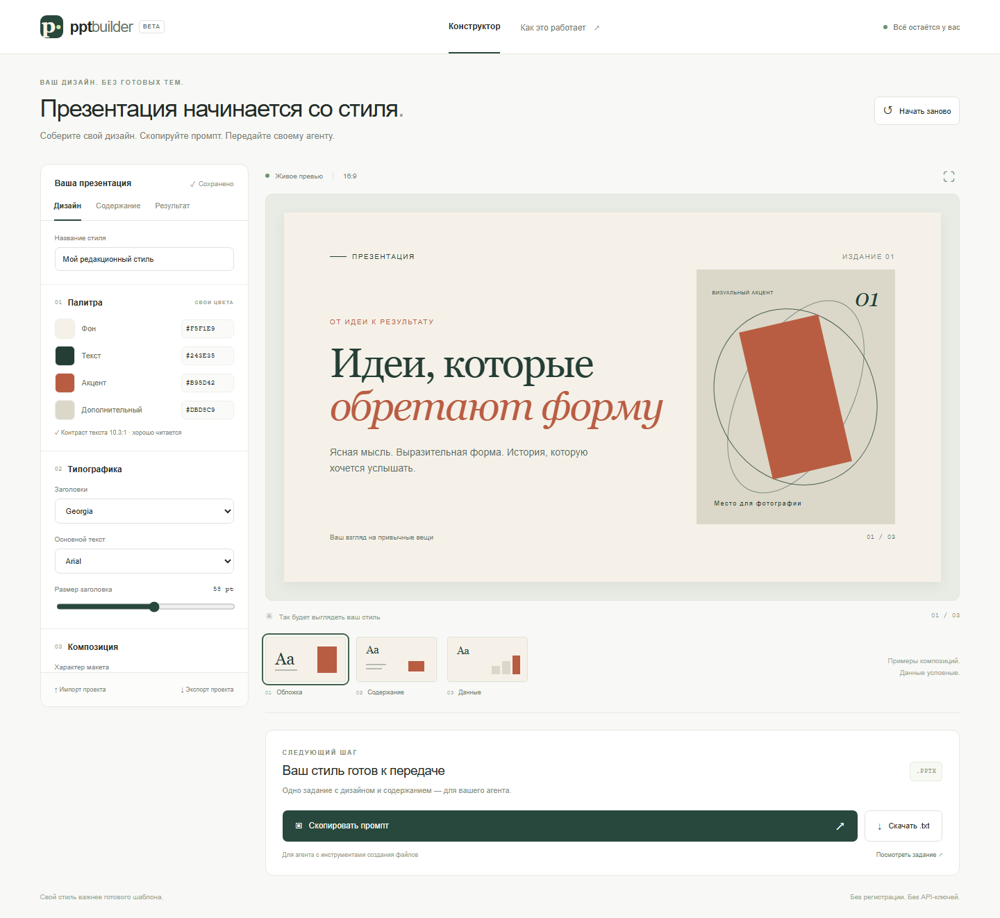

# PPT Builder

Визуальный конструктор собственного стиля презентации. Настройте дизайн, добавьте содержание и скопируйте самодостаточное задание для своего ИИ-агента.



## Возможности

- Своя палитра из четырёх цветов и проверка контраста текста.
- Выбор шрифтов, размера заголовка, композиции, выравнивания, плотности и скруглений.
- Три живых превью: обложка, содержание, данные. Это примеры стиля, а не результат генерации темы.
- Тема, аудитория, цель, исходные материалы, русский или английский язык.
- Задание на редактируемый PowerPoint или HTML-презентацию, 16:9 или 4:3.
- Копирование промпта с JSON, просмотр отдельной спецификации и скачивание `.txt`.
- Автосохранение в localStorage и перенос полного проекта через JSON.
- Адаптивный интерфейс, клавиатурная навигация и полноэкранное превью.

Сайт сам не генерирует презентации и не вызывает модели. Агенту нужны инструменты для выбранного формата. Результат зависит от модели, доступных инструментов, материалов и шрифтов. Превью использует доступные системные шрифты: конечный агент должен проверить их наличие, кириллицу и итоговый рендер.

## Локальный запуск

Нужен Node.js 22 или новее. У приложения нет runtime-зависимостей.

```sh
npm ci
npm run dev
```

Откройте http://127.0.0.1:3000. Для сборки статических файлов:

```sh
npm run build
```

Результат находится в `dist/`. Не открывайте `index.html` через `file://`: ES-модулям нужен HTTP-сервер.

## Деплой на Vercel

1. Откройте [New Project](https://vercel.com/new) в своём аккаунте Vercel.
2. Импортируйте GitHub-репозиторий `fatalbazuka/pptbuilde`. Если он не отображается, разрешите Vercel доступ к нему в настройках GitHub App.
3. Оставьте Root Directory `./`. Framework Preset — **Other**. Настройки уже заданы в `vercel.json`: Build Command — `npm run build`, Output Directory — `dist`.
4. Нажмите **Deploy**. Переменные окружения и API-ключи не нужны.

После привязки репозитория Vercel сможет создавать preview deployments для веток/PR и обновлять production при push в `main`. Деплой и адрес создаются в вашем аккаунте Vercel; файл конфигурации сам по себе не публикует сайт.

В `vercel.json` также заданы CSP и защитные HTTP-заголовки. Приложение не использует CDN, аналитику или внешние шрифты.

## Проверки

```sh
npm test
npx playwright install chromium
npm run test:e2e
```

Unit-тесты проверяют перенос настроек, нормализацию импортов, контраст и содержание экспортируемого задания. Браузерные тесты проверяют реальные элементы управления, clipboard, сохранение, импорт/экспорт, превью, reset, мобильную вёрстку и безопасный вывод пользовательского текста. Chromium скачивается только для локальных/CI-проверок, не при деплое сайта.

## Файлы

- `core.mjs` — схема, нормализация, проверка контраста и генерация промпта.
- `app.mjs` — интерфейс, превью и localStorage.
- `styles.css` — оформление и адаптивная вёрстка.
- `scripts/build.mjs` — сборка статических файлов без bundler.
- `vercel.json` — конфигурация деплоя.

`pptbuilder-project.json` содержит `schema_version` и `settings` и предназначен для повторного импорта на сайт. JSON внутри промпта — спецификация для агента с отдельными разделами brief/design/output/quality.

## Данные

Материалы и настройки хранятся в localStorage браузера. Сайт не отправляет их на сервер, но они доступны другим пользователям того же профиля браузера. Экспорт проекта и копирование включают исходные материалы. Не сохраняйте секреты. «Начать заново» заменяет сохранённый проект начальными настройками.
